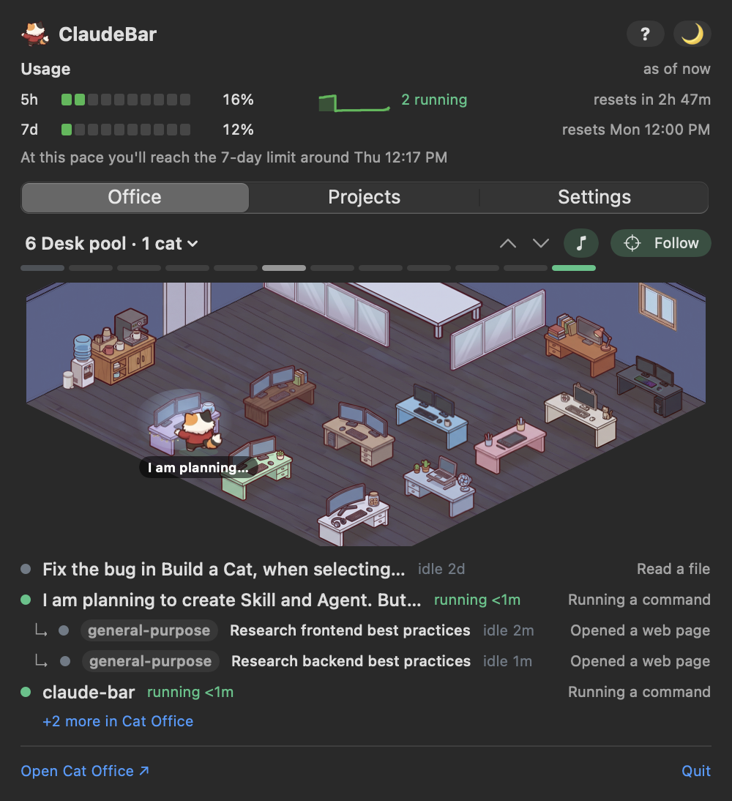

# ClaudeBar

A macOS menu bar companion for Claude Code and Cat Office: your usage limits, your projects, and a living office of
cats, one click away.



## Features

- **Usage in the menu bar:** your Claude Code 5-hour and 7-day limits, and how many sessions are running.
- **Where usage is heading:** a quiet line says where your pace leads ("On pace for about 55% of the 5-hour limit by
  5:40 PM"), a small sparkline shows your last 5 hours, one notification warns you before you'd hit a limit, and a
  click on the usage area folds out the last 7 days.
- **Projects:** each project's branch, model, context and status, and today's recap ("Today: 4 sessions finished,
  2h 10m of work, mostly claude-bar").
- **Answer a waiting session from the menu bar:** a permission, a question or a plan shows in the cat's hover card and
  under the office, with Allow / Deny (or the options) for sessions running in Orca. Every cat's card also has
  **Open in Cat Office** (on that cat's panel) and, for Terminal and iTerm sessions, **Show terminal**.
- **Your Cat Office, floor by floor:** every floor drawn exactly as your own Cat Office lays it out, with an elevator
  between floors, Follow, and a hover peek from the menu bar.
- **Cats that do what the browser shows:** while a Cat Office page is open, each cat is where the browser has it,
  doing the same thing; with no page open, ClaudeBar runs Cat Office's own office rules, so idle cats nap, read and
  snack in the Lounge.
- **Cats walk around furniture,** on the same routes as Cat Office, and ride the elevator between floors.
- **Name tags** on every cat, and a hover card with its project, branch, model and what it's doing in plain words.
- **Spare cats** (optional): the office's own cats roaming the building.
- **Sounds and lofi music,** generated from code (no recorded audio).
- **Quiet hours and a shortcut:** no sounds or notifications in the hours you pick (or for an hour, for meetings);
  ⌃⌥C (or your own keys) opens ClaudeBar from anywhere.
- **Speaks Cat Office's language:** statuses read as Cat Office names them (Needs you, Running, Idle, Ended), a
  teammate's own words included.
- **Works without Cat Office too:** usage and projects only, with a friendly invitation to try the office. With two
  copies of Cat Office running, ClaudeBar says so and can stop the extra one.
- **Safe to try:** a short setup window, every change backed up, and one-click undo.

## Requirements

- A Mac on macOS 14 or newer, with Apple's Command Line Tools (Swift 6). You have them if `git` works; else
  `xcode-select --install`, which may need IT on a company Mac.
- [Cat Office](#cat-office-patch-same-cats-as-the-browser-found-wherever-it-lives) running locally for the office
  (optional: without it you still get usage and projects).
- Access to this private repo.

## Getting started (no admin password needed)

```sh
git clone git@github.com:jbclores/claude-bar.git && cd claude-bar
scripts/run.sh             # checks the tools, builds, and opens ClaudeBar from this folder
scripts/run.sh --install   # or: copy it to ~/Applications and run it from there
```

- **No IT credentials:** building happens in this folder, and `~/Applications` is your own folder, not the system
  `/Applications`. A ClaudeBar you build yourself doesn't get macOS's "unidentified developer" warning.
- **First launch:** the Set up ClaudeBar window finds your Cat Office and turns on usage (see below).
- **Updating:** `git pull`, then `scripts/run.sh` again (with `--install` if you installed); it quits the old one.
- **Start at login:** tick Open at login in Settings. Use `--install` first, so it doesn't point into this folder.
- **Don't use `swift run`:** it leaves out the setup scripts, sounds and guide that `scripts/build.sh` bundles.

Doing it by hand: `scripts/build.sh` builds `build/ClaudeBar.app`; copy it to `~/Applications` and open it.

Config: `~/.config/claude-bar/projects.json` (Add folder… / Edit config file in the dropdown).

## What ClaudeBar changes (and how to undo it)

ClaudeBar is built to be safe to try. Nothing changes until you click Continue in setup, every change is backed up
first, and nothing of yours is deleted. It talks only to the Cat Office on your own Mac (`localhost`), and never
controls your Claude agents, projects or git.

| Place | What changes | Backup |
|---|---|---|
| `~/.config/claude-bar/` | ClaudeBar's settings | — (its own) |
| `~/.claude/claude-bar/` | ClaudeBar's usage files | — (its own) |
| `~/.claude/settings.json` | only the `statusLine` entry | `settings.json.claude-bar-backup-<time>` |
| `~/.claude/statusline-command.sh` | ClaudeBar's script, only if you chose it; plus small helper files `claude-bar-*` next to it | `statusline-command.sh.claude-bar-backup-<time>` |
| your Cat Office folder | the patch | `.cat-office/patch-backup-<time>/` |

ClaudeBar's own small files: its art cache `~/Library/Caches/ClaudeBar/` and log `~/Library/Logs/ClaudeBar/`; the
helpers `~/.claude/claude-bar-hook.sh` and `claude-bar-statusline.sh` (only if you kept your own status line) and its
record `~/.claude/claude-bar-statusline-original.json`; `~/.cat-office/plan-usage.json` (your usage, for Cat Office);
and its macOS preferences (the last Cat Office folder it saw, the last tab). "Also remove ClaudeBar" moves
`~/.config/claude-bar/`, `~/.claude/claude-bar/`, the cache and the log to the Trash, plus the two helpers once
`settings.json` no longer runs them. The record, `plan-usage.json` and the preferences stay (`defaults delete
com.jbclores.claudebar` removes the preferences).

Patching or unpatching Cat Office restarts it, which ends the Claude sessions running inside Cat Office (you're warned
first).

**Undo:** Settings → **Undo ClaudeBar's changes…**, or `ClaudeBar --undo` (`--remove` to remove ClaudeBar too) from the
binary inside the app. The full page, with the by-hand steps: `Resources/Help/changes.html` (also in the app's guide).
By hand, copying a backup back replaces those files and loses changes made to them since, so the page shows how to
put back just the `statusLine` entry (from `claude-bar-statusline-original.json`), and when to re-download Cat Office
instead.
Changed your mind? You can undo everything in a minute, and set it up again whenever you like.

`scripts/test-undo-command.sh` tests `--undo` against a temp folder (after `scripts/build.sh`).

## Setting up ClaudeBar

On first launch ClaudeBar opens a small **Set up ClaudeBar** window (Welcome → Find Cat Office → Connect → Done). It
finds your Cat Office (or lets you choose its folder, or say you don't use it), then on Connect offers to patch Cat
Office, turn on usage in the menu bar (Claude Code's status line; your own is kept, ClaudeBar reads its data
quietly), and start Cat Office. Nothing on your Mac changes until you click Continue on Connect.

- **Skipping:** "Skip for now" (or closing the window) skips setup; it won't open by itself again. A Mac that's already
  set up (Cat Office known and the status line in place) never sees the window.
- **Reopening:** Settings → **Set up ClaudeBar…**, or the card in the Office tab ("Cat Office isn't set up yet · Set
  up…", or "Some extras are off · Fix…" when the patch or usage is off).
- **Undo the status line:** Settings → **Restore my old status line** (shown only after setup replaced or wrapped a
  status line you already had, while that change is still in place).
- **Click test** (temp folders only, offscreen): `build/ClaudeBar.app/Contents/MacOS/ClaudeBar --test-setup`.

The scripts below still work for doing it by hand.

## Cat Office patch (same cats as the browser, found wherever it lives)

To move Cat Office and patch it in one go (stops it, moves it, patches it, updates the config, starts it):

```sh
scripts/move-cat-office.sh ~/Downloads/cat-ai-office-with-art-20261006-1038 ~/Documents/projects/cat-ai-office-with-art-20261006-1038
```

Or patch it where it is:

```sh
scripts/patch-cat-office.sh <cat-office-folder>
# then restart Cat Office: stop its dev server, run `npm run dev` again
```

The patched Cat Office writes `~/.cat-office/bridge.json` (address, token, its folder) while it runs, so ClaudeBar
finds it on any port and remembers its folder for starting it after a move.

It does a trial run first, backs up the touched files to `<cat-office>/.cat-office/patch-backup-*`, and changes
nothing if a newer Cat Office no longer matches. To undo, use `scripts/patch-cat-office.sh --undo <cat-office-folder>`,
or see the by-hand steps in `Resources/Help/changes.html`.

## Floors

The Office tab and the hover peek show Cat Office's building one floor at a time: idle cats in the Lounge, working
cats on their project's floor (else the Desk pool), helpers beside their parent. The floor menu, ▲▼ and the strip pick
a floor; Follow (on whenever the dropdown opens) shows where things happen. Cats ride the elevator between floors.

Each floor is drawn from that Cat Office's own layout (`building.json` and its catalogues), so a teammate's ClaudeBar
shows their office. When Cat Office changes how rooms are laid out, re-run the fixtures
(`npx tsx <claude-bar>/scripts/room-fixtures.ts <in-dir> <out.json>` from the Cat Office folder) and `swift test`.

## Tests

```sh
swift test                                   # unit tests (Core: geometry, walking grid, mirror, simulation, setup, undo)
scripts/test-setup-scripts.sh <cat-office>   # the patch, undo and helper scripts, on temp copies (reads <cat-office> only)
scripts/test-statusline.sh                   # status line output unchanged + snapshots
scripts/test-undo-command.sh                 # ClaudeBar --undo against a temp folder (after scripts/build.sh)
CLAUDEBAR_LIVE=1 swift test                  # also against the running Cat Office
```

Click tests run offscreen from the built app: `build/ClaudeBar.app/Contents/MacOS/ClaudeBar --test-tabs`,
`--test-zoom`, `--test-setup`, `--test-undo`, `--test-shortcut` (records ⌃⌥K in the shortcut box; nothing is saved), `CLAUDEBAR_NO_DATA=1 … --test-start` (the Start Cat Office button takes
its click; it never starts Cat Office), and `CLAUDEBAR_RENDER_WAITING=permission CLAUDEBAR_RENDER_WAITING_EXTERNAL=1 … --test-answer` (clicks the hover card's
Deny over the room and the waiting row's Allow; checks the answer each would send and "Sent"; nothing is sent).

Some tests compare ClaudeBar with Cat Office's own code. When Cat Office changes, regenerate their fixtures from the Cat
Office folder (it is only read):

```sh
npx tsx <claude-bar>/scripts/room-fixtures.ts <in-dir> <out.json>   # floors, walking grids and routes
npx tsx <claude-bar>/scripts/sim-fixtures.ts <in-dir> <out.json>    # the office simulation's rules
```

## Design docs

How each part was designed and why: `docs/superpowers/specs/` (start with `2026-10-06-claude-bar-design.md`), and the
step-by-step plans in `docs/superpowers/plans/`.
